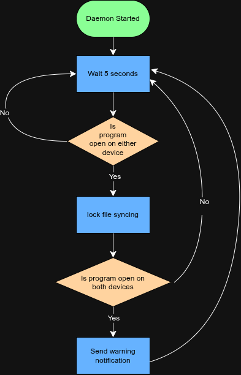

# Sync-Guard

A Bash daemon to prevent syncing of live files and warn of changes that would cause conflicts.

## The Problem

File sync programs like Syncthing will have sync errors when computers edit the same file and attempt to sync with each other. This script warns the user of competing changes and prevents incomplete data transfers for Syncthing.

## How It Works

This daemon checks running programs against a set list. When one is found, it temporarily disables the syncing of related files, as well as notifies the other computers in a list over tailscale or local networks. If 2 or more computers are running the program, it warns all of those computers with a notification. 

## Tech Stack

- **Language:** Bash
- **Libraries:** any external dependencies
- **External tools:** cron, curl, APIs, etc. tailscale, syncthingy, nc, pgrep

## Setup

TBD

## Usage

TBD

## Roadmap

Features you haven't built yet but plan to (pull these from your
"Schedule" quadrant in the Eisenhower Matrix).

- [ ] GUI/Control Panel
- [ ] Extended rule selection
- [ ] Raspberry Pi Server
more rule options such as when on ethernet or AC power

## Author

[Wolfzoned](https://github.com/WolfZoned)
